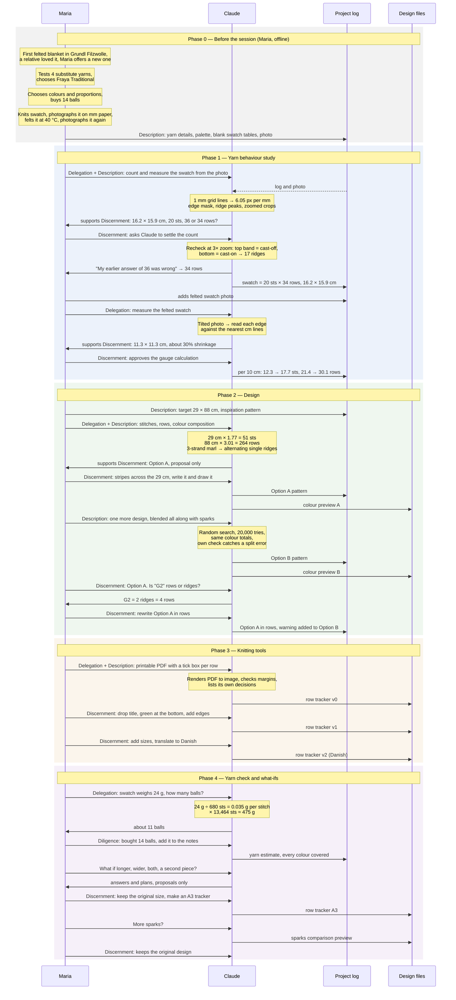
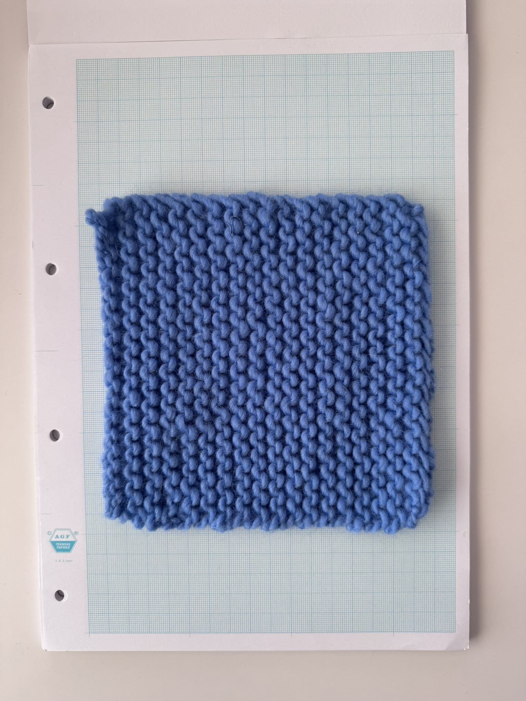
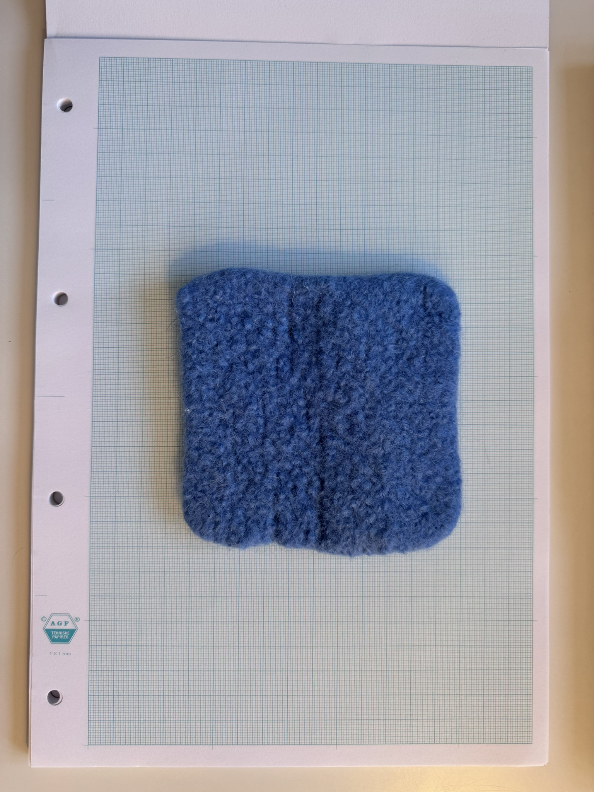
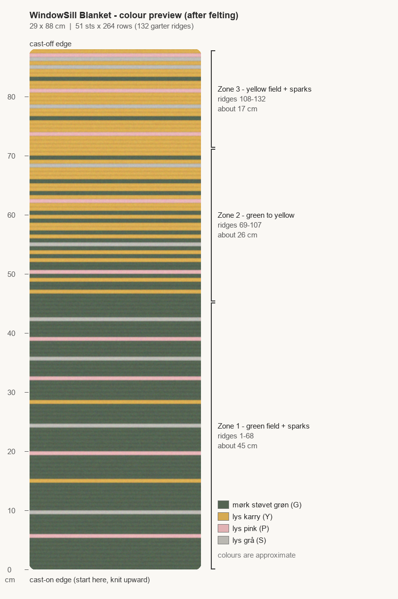
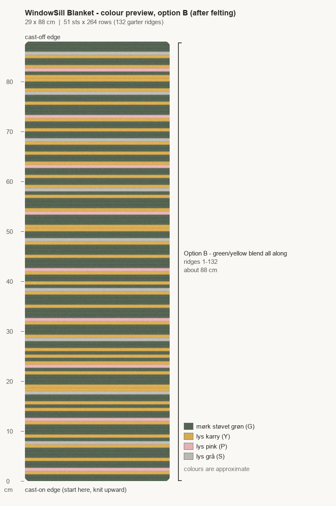
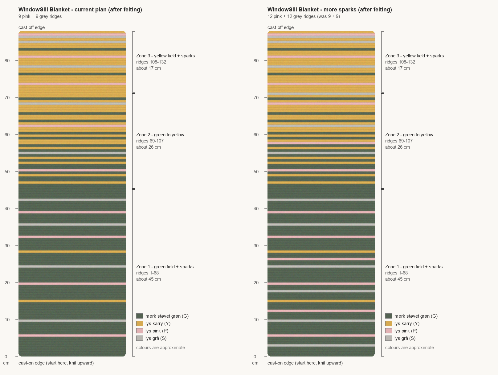

# How Maria and Claude designed Blanket #1: Windowsill

## The story

This project follows on from Maria's first felted blanket, knitted in Grundl Filzwolle. A relative liked it so much that Maria offered to knit one for them, sized to fit a windowsill.

The goal of working with Claude was a step-by-step knitting pattern for a striped blanket measuring 29 × 88 cm after felting. Felting shrinks wool, so the pattern had to be planned backwards from the finished size. Claude helped measure how much the chosen yarn shrinks, then turned those numbers into stitch and row counts, a colour plan and a printable row tracker.

Grundl was not available locally, so Maria tested four substitutes:
- Drops Snow
- Fraya Traditional
- Hjerte Garn Natur Uld
- Lana Grossa Feltro Color Melange

She chose Fraya Traditional, which felted most like the original. From there, the design came together in a single session of about an hour and a half.

The next chapter happens on the needles: knitting, felting, and the finished blanket on the windowsill.

## How the work was shared

Maria used this project to explore Claude's capabilities in a creative craft:
- **Reading images:** measuring knitted swatches and counting stitches and rows from photos
- **Reading knitting patterns:** understanding an existing pattern and adapting it to a different yarn set-up
- **Creative design:** creating a new stripe pattern based on Maria's instructions and an existing example
- **Step-by-step instructions:** turning the design into a printable row-by-row tracker

The work followed a simple rule: Claude proposes, Maria decides. The final creative choices stayed with her.

Each step in the diagram below is tagged with one of the four principles of AI Fluency (the **4Ds**):

| D | Meaning in this project |
|---|---|
| **Delegation** | Deciding which tasks suit Claude and which stay with Maria. Here: Claude took on measuring, calculating and drafting; Maria kept the physical work and every design decision. |
| **Description** | Communicating goals, context and constraints clearly. Here: target size, colour palette, inspiration pattern and the single-strand rule. |
| **Discernment** | Critically evaluating Claude's output before accepting it. Here: questioning the row count and the notation, and reviewing every design and PDF version. |
| **Diligence** | Taking responsibility for the result and being transparent about AI's role. Here: keeping a project log and publishing this account of who did what. |

On Claude's arrows, **"supports X"** marks behaviour that enabled Maria's 4D practice, such as flagging uncertainty, waiting for approval and disclosing its own decisions.

## The process at a glance

The diagram reads from top to bottom, one phase after another. Each arrow shows who passed what to whom, labelled with the D it demonstrates. Grey notes summarise the method behind Claude's results, and the sections below the diagram explain each step in full.

## The full story, phase by phase

### Phase 0 — Before the session
*Maria, offline*

With Fraya Traditional chosen, Maria laid the groundwork by hand. The main colour, mørk støvet grøn (dark dusty green), was matched to her relative's preferred colours. Lys karry (light curry), lys pink (light pink) and lys grå (light grey) were Maria's own choice as supporting colours, and the 8 + 4 + 1 + 1 balls she bought set the colour ratios of the design.

Next came a swatch that could be measured. Maria knitted it in garter stitch (single strand, 8 mm needles, 12 stitches × 17 rows plus a border) and photographed it on 1 mm technical paper, deliberately, so that the grid would give the photo its own scale. She then felted it in a washing machine at 40 °C, using standard washing powder rather than a wool detergent and adding an old towel to increase felting, and photographed it again on the same paper.

Everything went into a structured project log, with empty tables waiting for measurements. One question remained open: Maria was not sure of her own row count, so she marked it with question marks. That became the first task for Claude.

### Phase 1 — Yarn behaviour study
*Maria and Claude*

The first goal was to understand how Fraya Traditional changes when felted. Working in "Claude-coop" mode, where Claude proposes and Maria decides, Maria asked Claude to confirm the stitch and row count from the photo.

Claude used the technical paper as a ruler. It located the 1 mm grid lines from the pattern of light and dark pixels, giving a scale of about 6.05 pixels per millimetre, then traced the swatch edges by colour, ignoring the loose yarn tail. Counting the garter ridges as regular bright bands and checking them by eye in zoomed crops, it arrived at 16.2 × 15.9 cm and about 20 stitches. The row count was less certain, and Claude said so rather than guessing:
> "Rows: 36 (my count) or 34 (your plan)?"

Maria did not pick a number. Verifying the row count was exactly the task she had delegated, so she asked Claude to settle it. Looking again at 3× zoom, Claude found that the top and bottom bands were the cast-off and cast-on edges, not ridges, and corrected itself openly:
> "My earlier answer of 36 was wrong."

The swatch had 17 ridges, or 34 rows.

The felted swatch brought a new difficulty: its photo was taken at a slight angle, so a single scale for the whole picture would have been wrong. Claude measured each edge against the nearest centimetre lines instead and arrived at 11.3 × 11.3 cm, about 30% smaller in both directions. Since felting shrinks stitches without adding or removing any, the counts stayed the same. Claude added one caveat: thicker felted fabric sits closer to the camera, so it may look slightly larger than it is.

| Before felting | After felting |
|---|---|
|  |  |

With Maria's approval, Claude turned these measurements into gauge:

| | Before felting | After felting |
|---|---|---|
| Size | 16.2 × 15.9 cm | 11.3 × 11.3 cm |
| Stitches per 10 cm | 20 ÷ 16.2 × 10 = **12.3** | 20 ÷ 11.3 × 10 = **17.7** |
| Rows per 10 cm | 34 ÷ 15.9 × 10 = **21.4** | 34 ÷ 11.3 × 10 = **30.1** |

The two "after felting" numbers, 17.7 stitches and 30.1 rows per 10 cm, became the foundation of the design.

### Phase 2 — Design
*Maria and Claude*

With the gauge known, Maria turned to the design. She extended the project log with the target size of 29 × 88 cm after felting, the colour palette and her inspiration, Fraya's [Campfire blanket](https://www.selfmade.com/da-dk/fraya-strikkeopskrift-campfire-dip-dye-plaid-boligdekoration-fraya9002/), and asked Claude to work out the stitches, rows and colour composition: green and yellow with sparks of pink and grey, knitted with a single strand.

Claude started from the finished size and worked backwards. At 17.7 stitches and 30.1 rows per 10 cm after felting, a 29 × 88 cm blanket needs 51 stitches and 264 rows. On the needles it will measure about 41 × 123 cm, and felting will bring it down to size. Claude noted the margin of error carried over from the photos: about ±0.8 cm in width and ±2.5 cm in length.

The real challenge was the colour. The Campfire pattern is knitted with three strands and blends colours by holding two of them together, which a single strand cannot do. Claude's solution was to alternate single ridges of the two colours, so they blend by eye instead. Keeping every colour block at least one ridge high meant unused colours could be carried up the side without cutting the yarn. Following Maria's ratios, the blanket came out at 76 ridges of green, 38 of yellow and 9 each of pink and grey, arranged in three zones: green with sparks, a green-to-yellow transition, and yellow with sparks.

Maria chose to run the stripes across the width, and Claude drew a to-scale colour preview, noting that its colours were only an approximation of the real yarn. To see what else was possible, Maria asked for a second design with the colours blended along the whole length. Claude generated it with a constrained random search that kept the colour totals identical, and its own check caught and fixed an error before the result reached Maria.

| Option A: three zones | Option B: blended all along |
|---|---|
|  |  |

Seeing both side by side, Maria chose the first design. One detail still needed attention: she noticed that a code like "G2" could mean two rows or two ridges. Claude confirmed it meant ridges, and at Maria's request rewrote the pattern in rows, the same convention the inspiration pattern uses, so it could be followed without any guesswork.

### Phase 3 — Knitting tools
*Maria and Claude*

A pattern is only useful if it can be followed row by row, so Maria asked for a printable tracker: the colour drawing on one side, the row sequence on the other, and a box to tick off every row as it is knitted.

Claude built the PDF with code, then converted each version to an image to check it the way a reader would see it, measuring the margins to make sure nothing ran off the page. It also pointed out its own design choices, such as placing row 1 at the top, so that Maria could decide on them.

Maria reviewed each version as a knitter would use it. In the first round, to free up space, she removed the title, legend and instruction line. To match the colour preview, she turned the layout so the green section sat at the bottom. The first version left it unclear whether the first and last rows were the cast-on and cast-off, so Maria asked for this to be stated explicitly, with lines marking both edges. Claude's revision included a list headed:
> "Things I decided myself, so you can check them"

In the second round, Maria added the expected sizes before and after felting and asked for the page in Danish. Claude took its knitting terms from the Danish inspiration pattern and flagged the one word it had chosen itself.

Later, to save ink, Maria asked for an A3 version with a narrower colour drawing, accepting that it would lose its proportions, and a larger font for easier reading while knitting.

### Phase 4 — Yarn check and what-ifs
*Maria and Claude*

To find out whether the yarn she had bought would be enough, Maria weighed the swatch: 24 g. Felting changes size, not weight, so Claude could work per stitch: 24 g across 680 stitches is about 0.035 g per stitch. The blanket's 13,464 stitches would therefore need about 475 g, or 11 balls. Maria had bought 14, so every colour was covered, with about 225 g to spare, and she asked Claude to record the estimate in the project log.

The surplus made it possible to evaluate alternatives. Maria wanted to establish which design would work best visually and which size would make the most efficient use of the yarn. Claude derived unit values from the swatch, the yarn consumption and felted dimensions of a single ridge and a single stitch, and applied a 10% safety margin. On that basis, the surplus would support approximately 30 cm of additional length, or an overall width of approximately 38 cm. For the design, the pink and grey yarn would allow up to 12 sparks of each colour instead of 9, which Claude illustrated in a side-by-side comparison.

These calculations enabled Maria to compare designs and sizes, verify the yarn requirements for each, and reach an informed decision. She selected the original design and dimensions as the most practical solution: a blanket that fits the windowsill precisely, without extending onto the window or wall, where it could collect moisture. The session concluded with a complete pattern, verified measurements and a confirmed yarn supply.

## What comes next

The pattern is ready; the knitting is not. The next steps are on the needles: knitting 264 rows, felting the blanket, and checking whether it shrinks to 29 × 88 cm as planned. A photo of the finished blanket will be added here.
